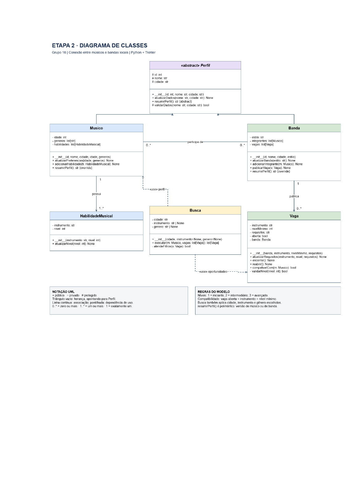
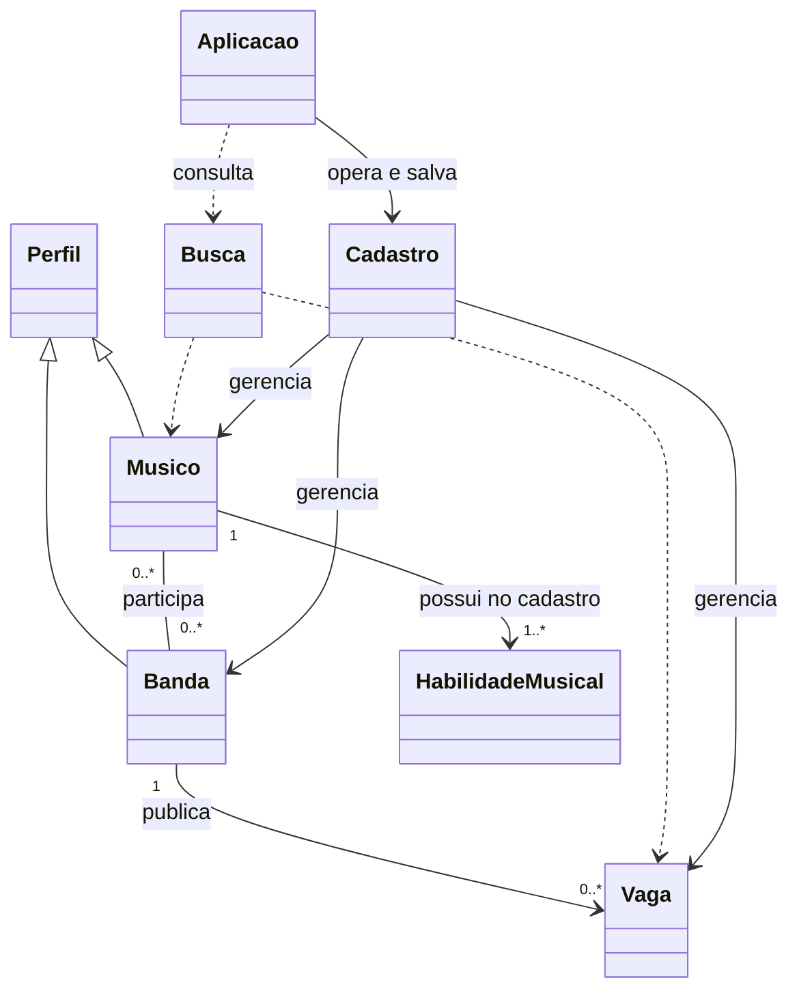

# Timbre — Etapa 3: documentação e demonstração

**Grupo 16**  
**Integrantes:** Iago Boettge; Marcus Vinicius Rodrigues de Jesus; Samuel Almeida Giacomelli; Fernanda Silva Bettanin.  
**Data:** 02/11/2026  
**Demonstração prevista:** 05/11/2026

## 1. Proposta e materiais das etapas anteriores

O Timbre procura facilitar o encontro entre músicos e bandas locais. O músico registra seus dados, instrumentos, níveis de habilidade e gêneros de interesse. As bandas cadastram seus perfis e publicam vagas com instrumento, nível mínimo e requisitos. A busca apresenta oportunidades compatíveis com o músico e os filtros selecionados.

A proposta prevê cadastro e atualização de músicos e bandas, gerenciamento de vagas e filtros por cidade, instrumento e gênero musical. A base inicial acrescenta exclusão de registros e gravação em JSON local para permitir um fluxo completo de CRUD.

- [Etapa 1 — proposta original completa](Etapa-1-Proposta.pdf), incluindo planejamento e responsabilidades.
- [Etapa 2 — documento original completo](Etapa-2-UML.pdf).



*Figura 1 — Modelagem original recebida do grupo.*

## 2. Estado da implementação e repositório

**Repositório remoto da equipe:** [IagoBoettge/Timbre](https://github.com/IagoBoettge/Timbre).

Na consulta realizada nesta atividade, a branch `main` continha somente o README. A implementação descrita a seguir foi criada localmente a partir dos materiais recebidos e acompanha este pacote. Ela ainda não foi publicada no repositório remoto. Seus resultados de teste não se referem à versão atualmente publicada no GitHub.

O pacote contém classes de domínio, CRUD com persistência local, interface Tkinter e demonstração pelo terminal. A lógica e a persistência foram testadas automaticamente; a interface foi importada sem erro, mas o uso visual e os fluxos interativos ainda não foram verificados.

## 3. Classes do projeto e orientação a objetos

| Classe | Função implementada |
|---|---|
| `Perfil` | Classe abstrata com identificador, nome, cidade, validação e atualização dos dados comuns. Define `resumirPerfil()` como abstrato. |
| `Musico` | Herda de `Perfil`; reúne idade, gêneros e habilidades. Atualiza preferências, adiciona habilidades e produz um resumo próprio. |
| `Banda` | Herda de `Perfil`; reúne estilo, integrantes e vagas. Adiciona/remove integrantes, publica/remove vagas e produz um resumo próprio. |
| `HabilidadeMusical` | Representa instrumento e nível de 1 a 3. Valida e atualiza o nível. |
| `Vaga` | Mantém banda, instrumento, nível mínimo, requisitos e estado. Atualiza requisitos, encerra/reabre e verifica compatibilidade com um músico. |
| `Busca` | Aplica os filtros escolhidos e retorna somente vagas abertas e compatíveis. |
| `Cadastro` | Coordena cadastros por ID, exclusões, atualização de vínculos e leitura/gravação JSON. Foi adicionada à implementação. |
| `Aplicacao` | Monta as abas Tkinter e liga as ações da interface às regras e aos cadastros. Foi adicionada à implementação. |

**Herança:** `Musico` e `Banda` especializam `Perfil`. **Polimorfismo:** cada uma implementa `resumirPerfil()` de acordo com seus dados. **Associação:** bandas referenciam seus integrantes e vagas, e cada vaga referencia uma banda. **Encapsulamento:** atributos específicos das classes de domínio utilizam `__` e propriedades de leitura; `Perfil` utiliza atributos protegidos por convenção, com `_`. `Vaga.__validarNivel()` é um método privado e `Perfil._validarDados()` é protegido por convenção.

### Ajustes em relação ao UML original

Foram acrescentadas as classes `Cadastro` e `Aplicacao`, além de métodos de remoção necessários ao CRUD. As vagas recebem IDs no cadastro, embora o UML original não declare um atributo ID para `Vaga`. Métodos protegidos/privados usam a nomenclatura de Python: `_validarDados()` e `__validarNivel()`. As classes restantes preservam os nomes e as responsabilidades centrais da modelagem.



*Figura 2 — Relações da implementação inicial. O cadastro exige ao menos uma habilidade para cadastrar ou atualizar um músico.*

## 4. Bibliotecas e classes externas utilizadas

Todas as dependências pertencem à biblioteca padrão do Python; não há pacotes de terceiros para instalar com `pip`. O ambiente precisa disponibilizar Tkinter/Tcl/Tk. A versão verificada foi Python 3.12.14 com Tk 8.6.

| Biblioteca / classes | Uso real |
|---|---|
| `tkinter`: `Tk`, `StringVar` | Janela principal e valores dos campos. |
| `tkinter.ttk`: `Notebook`, `Frame`, `Label`, `Entry`, `Button`, `Treeview` | Abas, formulários, botões e tabelas da interface. |
| `tkinter.messagebox` | Mensagens de erro e confirmação de exclusão. |
| `abc`: `ABC`, `abstractmethod` | Definição da classe abstrata `Perfil`. |
| `json` | Conversão dos cadastros entre objetos e arquivo JSON. |
| `pathlib.Path` | Caminhos dos arquivos de dados e de testes. |
| `os.replace` | Substituição do arquivo de dados após gravar um arquivo temporário. |
| `unicodedata` | Comparação de filtros ignorando diferenças de acentos. |
| `copy.deepcopy` | Cópia do cadastro antes de uma alteração pela interface; restauração em caso de falha de validação ou gravação. |
| `unittest.TestCase` | Execução dos testes automatizados. |
| `tempfile.TemporaryDirectory` | Dados isolados usados nos testes e na demonstração. |

As classes do domínio são próprias do projeto. GitHub é a plataforma de hospedagem; UML é a notação de modelagem.

## 5. CRUD e persistência

| Operação | Funcionamento implementado |
|---|---|
| **Criar** | Cadastro de músicos com habilidades, bandas e vagas; adição de integrantes às bandas. |
| **Consultar** | Listagem dos cadastros e seus IDs; consulta de integrantes e busca de vagas compatíveis. |
| **Atualizar** | Alteração de perfis, habilidades, estilo da banda e requisitos da vaga; encerramento e reabertura de vagas. |
| **Excluir** | Exclusão de músicos, bandas e vagas; remoção de integrantes. |

Excluir um músico remove suas associações com bandas. Excluir uma banda também exclui as vagas que pertencem a ela. Excluir uma vaga a remove da lista de oportunidades da banda. Encerrar uma vaga apenas altera seu estado e permite reabertura.

A interface salva os dados após cada alteração em `data/timbre.json`. O carregamento reconstitui músicos, bandas, vagas e seus vínculos. Identificadores são sequenciais e não são reutilizados após exclusão. Não há banco SQL nem servidor remoto nesta versão.

Campos obrigatórios não aceitam texto vazio. Idade deve ser um inteiro não negativo. Níveis devem ser inteiros de 1 a 3. Instrumentos repetidos no mesmo perfil são recusados, desconsiderando acentos, espaços nas extremidades e diferenças entre maiúsculas e minúsculas.

## 6. Regras de busca

A vaga precisa estar aberta e o músico deve possuir o instrumento solicitado em nível igual ou superior ao mínimo. Os filtros opcionais de cidade, instrumento e gênero são combinados: todos os filtros preenchidos devem ser atendidos.

Filtros vazios não restringem a busca por aquele campo. As comparações ignoram acentos, diferenças de maiúsculas/minúsculas e espaços nas extremidades. Gênero é comparado ao estilo da banda quando o filtro é informado; os gêneros do perfil do músico não são aplicados automaticamente.

## 7. Telas e capturas

A interface está escrita em `app.py`. As capturas reais e a revisão visual permanecem pendentes.

| Aba criada | O que representa |
|---|---|
| **Músicos** | Cadastro de nome, cidade, idade, gêneros e habilidades; listagem, seleção, atualização e exclusão. |
| **Bandas** | Cadastro de nome, cidade e estilo; listagem e edição das bandas. |
| **Vagas** | Cadastro por ID da banda, instrumento, nível mínimo e requisitos; atualização, exclusão, encerramento e reabertura. |
| **Integrantes** | Adição e remoção de vínculos entre músicos e bandas pelos IDs. |
| **Buscar oportunidades** | Busca pelo ID do músico e filtros opcionais; tabela com banda, cidade, estilo, instrumento, nível e requisitos. |

## 8. Testes realizados

Foram executados **19 testes automatizados, todos aprovados**, nas regras e na persistência desta base local. O registro está em [resultados-testes.txt](resultados-testes.txt). Esses testes não comprovam o funcionamento visual da interface.

| Cenário | Resultado observado |
|---|---|
| Vaga aberta, instrumento igual e nível do músico igual ao mínimo | Retornada na busca. |
| Nível insuficiente ou instrumento diferente | Vaga descartada. |
| Encerrar e reabrir vaga | Deixa de ser compatível e volta a ser compatível. |
| Filtros de cidade, instrumento e gênero incompatíveis | Vaga descartada em cada caso. |
| Acentos, espaços nas extremidades e maiúsculas nos filtros | Comparação reconhece os valores equivalentes. |
| Níveis inválidos, idade negativa e cadastros incompletos | Entradas recusadas. |
| Atualização inválida | Cadastro anterior preservado. |
| Múltiplas habilidades e instrumento duplicado | Compatibilidade considera cada habilidade; duplicata é recusada. |
| Atualizar ou excluir músico integrante de banda | Vínculos atualizados ou removidos. |
| Excluir banda ou vaga | Dependências removidas; outras bandas e músicos preservados. |
| Atualizar cidade/estilo da banda | Busca usa os novos dados. |
| Abstração e polimorfismo | `Perfil` não pode ser instanciado; músico e banda geram resumos distintos. |
| Salvar e carregar JSON | Dados, estado da vaga, sequência de IDs e vínculos restaurados. |
| Arquivo ausente ou JSON corrompido | Ausente inicia cadastro vazio; JSON inválido gera erro e permanece preservado. |
| Exclusão seguida de novo cadastro | ID excluído não é reutilizado. |

### Demonstração executada pelo terminal

O arquivo `demo.py` cria o músico fictício Alex, a banda Horizonte e uma vaga de guitarra nível 2. A busca inicial retornou uma vaga; após encerrá-la retornou zero; após reabri-la retornou uma novamente. A leitura do JSON recuperou um músico, uma banda e uma vaga. O registro está em [resultado-demo.txt](resultado-demo.txt).

### Reproduzir os resultados

Na pasta principal do projeto:

```text
python -m unittest discover -s tests -v
python demo.py
```

Os testes e a demonstração usam arquivos temporários e não alteram o cadastro da interface.

## 9. Limitações e bugs conhecidos

Não restaram falhas reproduzidas nos cenários dos 19 testes aprovados. A ausência de falhas nessa cobertura não garante que toda a aplicação esteja livre de erros. A interface foi importada, mas ainda não foi exercitada visualmente.

Limitações desta versão:

- Armazenamento local em JSON, sem sincronização entre computadores nem suporte a duas instâncias gravando simultaneamente.
- Uso de IDs digitados para relacionar registros, o que exige consultar as listas antes de preencher alguns campos.
- Instrumentos e estilos são textos livres. A normalização não reconhece sinônimos, abreviações nem cidades por proximidade geográfica.
- Cada banda possui um estilo; o sistema ainda não representa uma lista de estilos por banda.
- Requisitos adicionais da vaga são descritivos; a compatibilidade automática verifica instrumento, nível, estado e filtros escolhidos.
- Os gêneros do músico ficam cadastrados, mas só restringem a busca quando o filtro de gênero é preenchido.
- Para mudar a banda de uma vaga pela interface, é necessário excluir a vaga e criar outra.
- A interface usa tabelas simples sem ajuste específico para telas pequenas e ainda requer revisão de usabilidade.
- Não há instrução de instalação empacotada; a execução depende de Python e Tkinter disponíveis.
- O carregamento verifica os dados esperados pelo programa; edições manuais arbitrárias do JSON não são um fluxo suportado.

## 10. O que falta fazer

1. Revisar a implementação com os integrantes e integrar a base ao repositório da equipe.
2. Abrir a interface no computador da apresentação, conferir criação, seleção, edição, exclusão, busca e reabertura dos dados após reiniciar.
3. Incluir capturas reais e suas legendas na documentação.
4. Conferir a necessidade das extensões do modelo e atualizar o diagrama detalhado se o grupo as adotar.
5. Registrar problemas encontrados na revisão visual, com passos para reproduzi-los.
6. Ensaiar a demonstração e explicar os conceitos de orientação a objetos e os resultados dos testes.

## 11. Demonstração em aula

Para uma demonstração já verificada, executar `python demo.py` e explicar as três situações da busca e a gravação/recuperação dos dados. Mostrar `modelo.py` para explicar herança, polimorfismo, associação e método privado.

Após revisar a interface, executar `python app.py` e reproduzir o fluxo: cadastrar músico, banda e vaga; buscar a oportunidade; encerrar a vaga; repetir a busca; reabri-la. Encerrar apresentando os testes, as limitações e as pendências.

As instruções de execução e uso estão no [README principal](../README.md).
