# Timbre — Documentação Completa (Etapas 1, 2 e 3)

**Grupo:** Grupo 16  
**Integrantes:** Iago Boettge · Marcus Vinicius Rodrigues de Jesus · Samuel Almeida Giacomelli · Fernanda Silva Bettanin  
**Repositório Remoto (GitHub):** [https://github.com/IagoBoettge/Timbre](https://github.com/IagoBoettge/Timbre)  
**Data da Entrega e Demonstração:** 05/11/2026

---

## 1. Etapa 1 — Proposta do Projeto (Revisada e Atualizada)

### 1.1. Dados do Grupo e Ambiente de Desenvolvimento
- **Integrantes:** Iago Boettge, Marcus Vinicius Rodrigues de Jesus, Samuel Almeida Giacomelli e Fernanda Silva Bettanin (**Grupo 16**).
- **Ferramentas utilizadas:**
  - **GitHub:** hospedagem do repositório remoto, versionamento e integração por Pull Requests ([https://github.com/IagoBoettge/Timbre](https://github.com/IagoBoettge/Timbre)).
  - **Diagramas UML (draw.io / Mermaid):** modelagem de classes, dicionário de classes e especificação de entradas, saídas e persistência.
  - **Python 3 (Biblioteca Padrão) + Tkinter (`tkinter.ttk`):** implementação das regras de negócio, interface gráfica em abas, persistência em JSON (`data/timbre.json`) e testes automatizados (`unittest`).

### 1.2. Proposta do Projeto e Problema Resolvido
- **Problema a ser resolvido:** a dificuldade de encontrar integrantes compatíveis para bandas locais e, para o musicista, de localizar bandas próximas que precisem do seu instrumento no seu nível de experiência.
- **Proposta revisada:** aplicação desktop em Python + Tkinter onde o músico cadastra seus dados (nome, cidade, idade, gêneros musicais de interesse e habilidades musicais com nível de 1 a 3) e bandas locais cadastram seu perfil, seus integrantes e vagas abertas (instrumento procurado, nível mínimo de 1 a 3 e requisitos). O sistema cruza automaticamente as habilidades do músico com as vagas abertas e permite filtrar oportunidades por cidade, instrumento e gênero musical.

### 1.3. Requisitos — Evolução da Definição das Classes
Na Etapa 1 foram propostas 5 classes iniciais (`Musico`, `HabilidadeMusical`, `Busca`, `Vaga`, `Banda`). Na Etapa 2 foi introduzida a superclasse abstrata `Perfil` para aplicar herança e polimorfismo, e na Etapa 3 foram adicionadas as classes `Cadastro` (CRUD e persistência JSON) e `Aplicacao` (interface Tkinter):

| Classe | Origem | Responsabilidade Implementada |
|---|---|---|
| `Perfil` | Etapa 2 (UML) | Classe abstrata (`ABC`) com identificador (`_id`), `_nome`, `_cidade`, validação protegida (`_validarDados()`) e método abstrato `resumirPerfil()`. |
| `Musico` | Etapa 1 / Etapa 2 | Herda de `Perfil`; armazena `__idade`, `__generos` e `__habilidades` (`HabilidadeMusical`). Sobrescreve `resumirPerfil()`. |
| `Banda` | Etapa 1 / Etapa 2 | Herda de `Perfil`; armazena `__estilo`, `__integrantes` (`Musico`) e `__vagas` (`Vaga`). Sobrescreve `resumirPerfil()`. |
| `HabilidadeMusical` | Etapa 1 / Etapa 2 | Registra o instrumento que o músico toca (ou vocal) e o nível de habilidade (`1` = iniciante, `2` = intermediário, `3` = avançado). |
| `Vaga` | Etapa 1 / Etapa 2 | Representa uma oportunidade publicada por uma `Banda` com instrumento, nível mínimo (1 a 3), requisitos, estado (`__aberta`), método privado `__validarNivel()` e verificação `compativelCom(musico)`. |
| `Busca` | Etapa 1 / Etapa 2 | Procura oportunidades abertas e compatíveis com o perfil do músico, aplicando filtros opcionais de cidade, instrumento e gênero musical. |
| `Cadastro` | Etapa 3 (CRUD) | Gerencia dicionários em memória por ID (`musicos`, `bandas`, `vagas`), exclusões com integridade referencial e persistência atômica em `data/timbre.json`. |
| `Aplicacao` | Etapa 3 (GUI) | Constrói as 5 abas Tkinter (`Músicos`, `Bandas`, `Vagas`, `Integrantes`, `Buscar oportunidades`), tabelas `Treeview` e rollback em memória (`deepcopy`). |

### 1.4. Entrada e Saída de Dados
- **Entrada de dados:**
  - Nome, idade e cidade do músico.
  - Instrumentos que toca, nível de habilidade (1 a 3) e gêneros musicais de interesse.
  - Nome da banda, cidade, estilo musical e associação de integrantes por ID.
  - ID da banda, instrumento procurado, nível mínimo de experiência desejado e requisitos da vaga.
  - ID do músico e filtros opcionais (cidade desejada, instrumento e gênero musical) para a busca.
- **Saída de dados:**
  - Listagem dos músicos cadastrados com resumo polimórfico e habilidades musicais.
  - Listagem das bandas cadastradas com estilo musical e contagem/lista de integrantes.
  - Listagem das vagas cadastradas indicando banda, instrumento, nível mínimo, estado (`Aberta`/`Encerrada`) e requisitos.
  - Tabela de oportunidades compatíveis na aba de busca (banda, cidade, estilo, instrumento, nível e requisitos).
  - Alertas de validação (`messagebox`) e barra de status indicando gravação local.

### 1.5. Principais Funcionalidades do Programa
1. **Cadastro de músicos:** nome, cidade, idade, gêneros de interesse e múltiplas habilidades (`instrumento:nível`).
2. **Cadastro de bandas:** nome, cidade e estilo musical principal.
3. **Gerenciamento de integrantes:** adição e remoção de vínculos entre músicos e bandas.
4. **Cadastro de vagas:** publicação de vagas por banda, instrumento, nível mínimo (1 a 3) e requisitos opcionais.
5. **Busca de bandas compatíveis:** verificação automática de vaga aberta + instrumento correspondente + nível do músico >= nível mínimo da vaga.
6. **Filtro por cidade:** filtragem insensível a maiúsculas/minúsculas, espaços extras e acentos.
7. **Filtro por habilidade/instrumento:** restrição por instrumento procurado.
8. **Filtro por gênero musical:** restrição pelo estilo musical da banda.
9. **Visualização de oportunidades:** tabela detalhada com todas as vagas compatíveis.
10. **Atualização e exclusão de cadastros (CRUD completo):** edição e remoção de músicos, bandas e vagas com integridade referencial.
11. **Gerenciamento do estado da vaga:** encerramento e reabertura de vagas a qualquer momento.
12. **Persistência automática:** salvamento e carregamento em `data/timbre.json`.

### 1.6. Cronograma e Divisão de Responsabilidades

| Tarefa | Iago Boettge | Marcus Vinicius | Fernanda Silva | Samuel Almeida |
|---|:---:|:---:|:---:|:---:|
| Criação da UML e Dicionário de Classes | | X | | |
| Criação de classes | X | | | |
| Codificação | X | X | X | X |
| Identidade visual e prints de telas | | | X | |
| Implementação do Tkinter | | | | X |
| Criação e gestão do GitHub | | | X | X |
| Polimorfismo | | X | | |
| Herança | | | | X |
| Associação | X | | | |
| Método privado | X | | | |
| Atributo privado | | X | | |
| Teste do programa | | | X | |
| Elaborar os documentos das etapas do projeto | X | X | X | X |

---

## 2. Etapa 2 Completa e Diagramas UML (Original e Atualizado)

### 2.1. Diagrama de Classes UML Original (Etapa 2 — Página 1)
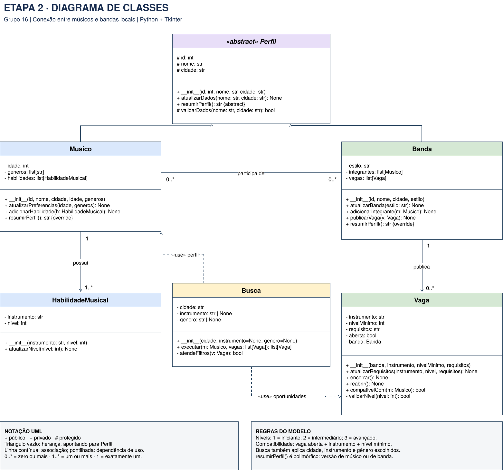

### 2.2. Dicionário das Classes (Etapa 2 — Página 2)
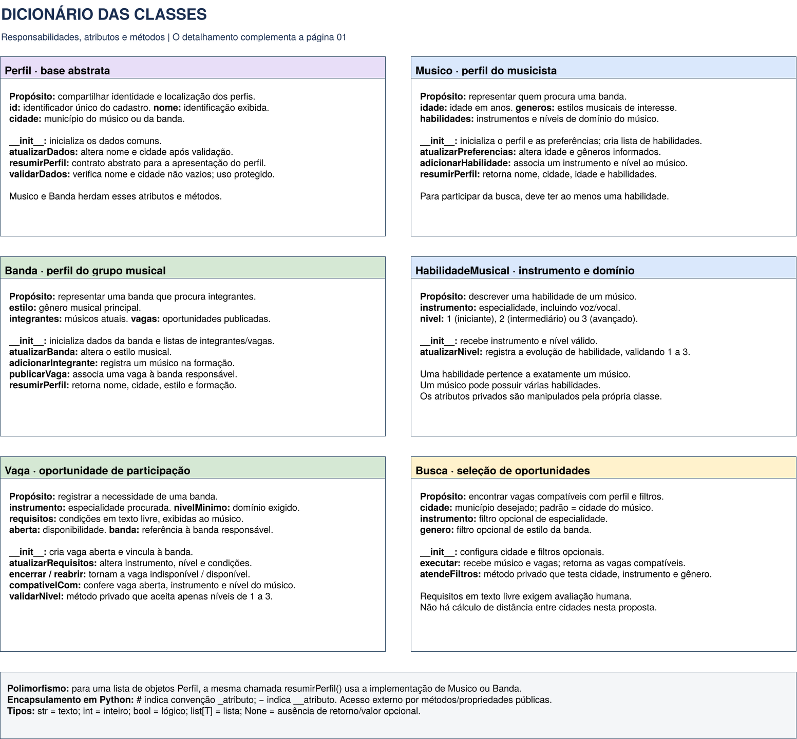

### 2.3. Entradas, Saídas, Interação e Persistência Proposta (Etapa 2 — Página 3)
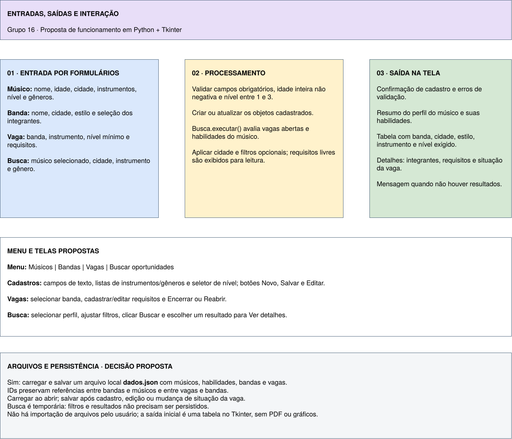

### 2.4. Diagrama de Classes UML Atualizado na Etapa 3 (Implementação Final)
Foram acrescentadas as classes `Cadastro` (`dados.py`) e `Aplicacao` (`app.py`), além dos métodos `removerIntegrante()` e `removerVaga()` em `Banda` para viabilizar o CRUD completo. As vagas recebem IDs sequenciais em `Cadastro.vagas[id]`. Os métodos protegidos/privados seguem a convenção de Python: `Perfil._validarDados()` (`#`) e `Vaga.__validarNivel()` (`-`).

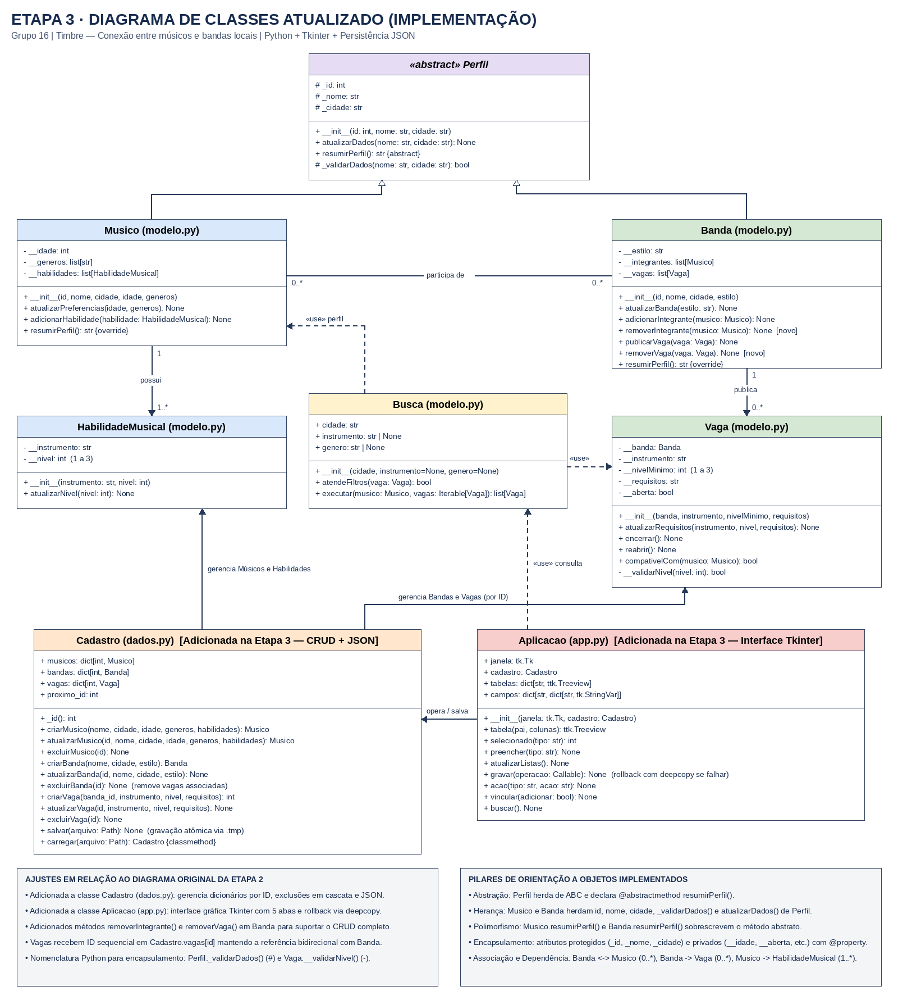

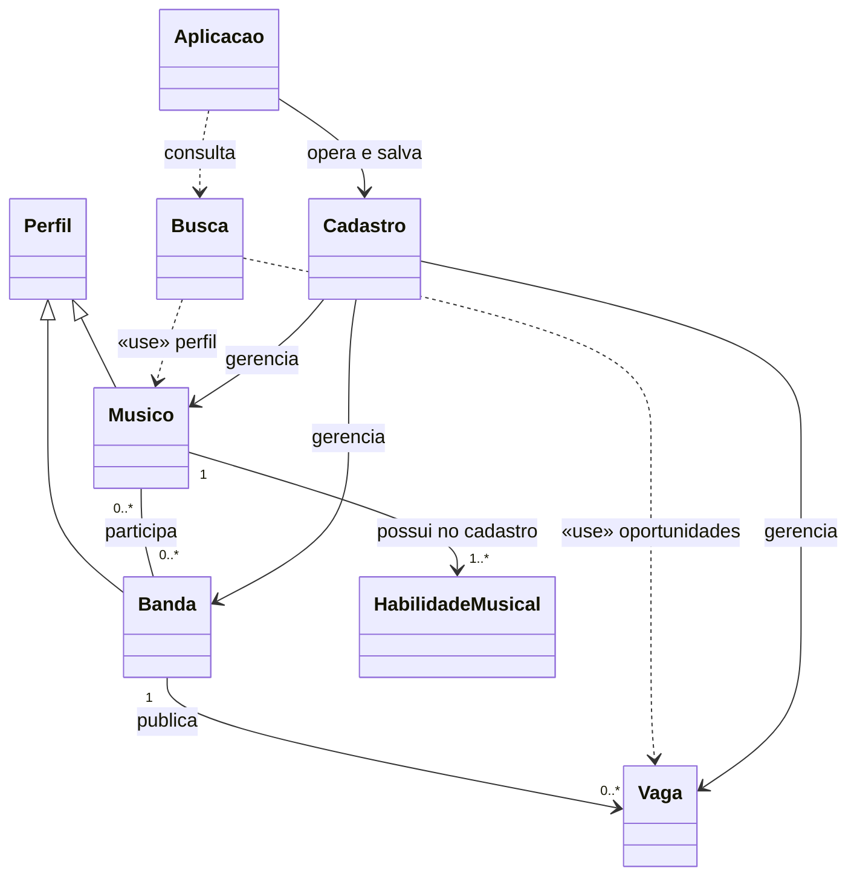

---

## 3. Link para o Repositório Remoto e Execução

- **Repositório GitHub do Projeto:** [https://github.com/IagoBoettge/Timbre](https://github.com/IagoBoettge/Timbre)
- **Documentos completos gerados no projeto:**
  - `Entrega-Final-Documentacao-Timbre-Grupo16.docx` e `Entrega-Final-Documentacao-Timbre-Grupo16.pdf` (documento consolidado com Etapas 1, 2 e 3, diagramas e anexos de telas).
  - `TIMBRE.docx` (atualizado com toda a documentação e prints).
  - `Diagrama UML - Grupo 16.docx` e `Etapa-2-UML.pdf` (modelagem completa da Etapa 2).
  - `Etapa-1-Proposta.pdf` (documento original da Etapa 1).

### Como Executar
```bash
# Interface gráfica Tkinter:
python3 app.py

# Demonstração pelo terminal:
python3 demo.py

# Suíte de 19 testes automatizados:
python3 -m unittest discover -s . -p "test_*.py" -v
```

---

## 4. Explicação das Classes Externas e Bibliotecas Utilizadas

Todas as dependências pertencem à **Biblioteca Padrão do Python** (verificado em Python 3.12.14 com Tk 8.6), não exigindo instalação de pacotes externos via `pip`:

| Biblioteca / Módulo | Classes / Funções | Explicação de Uso no Projeto |
|---|---|---|
| `tkinter` | `Tk`, `StringVar` | Criação da janela principal desktop e variáveis reativas ligadas aos campos de entrada e à barra de status em `app.py`. |
| `tkinter.ttk` | `Notebook`, `Frame`, `Label`, `Entry`, `Button`, `Treeview` | Construção das 5 abas (`Notebook`), painéis (`Frame`), rótulos, entradas de texto, botões de ação e tabelas interativas (`Treeview`). |
| `tkinter.messagebox` | `showerror`, `askyesno` | Caixas de diálogo modais para exibir erros de validação e confirmar exclusão de registros. |
| `abc` | `ABC`, `abstractmethod` | Definição da superclasse abstrata `Perfil` e do método abstrato `resumirPerfil()` em `modelo.py`. |
| `unicodedata` | `normalize`, `category` | Normalização Unicode (`NFD`) na função `chave()` para comparar cidades, instrumentos e estilos ignorando acentos e caixa. |
| `json` | `dumps`, `loads`, `JSONDecodeError` | Serialização e desserialização dos cadastros no arquivo `data/timbre.json` em `dados.py`. |
| `pathlib` | `Path` | Manipulação multiplataforma de caminhos de arquivos e criação automática da pasta `data/`. |
| `os` | `replace` | Substituição atômica do arquivo `data/timbre.json` a partir do arquivo temporário `data/timbre.json.tmp`. |
| `copy` | `deepcopy` | Cópia profunda de segurança do objeto `Cadastro` antes de cada alteração na interface; permite rollback imediato em caso de erro. |
| `unittest` | `TestCase`, `main` | Estruturação e execução dos 19 testes unitários automatizados em `test_timbre.py`. |
| `tempfile` | `TemporaryDirectory` | Criação de diretórios temporários isolados para testar persistência em `test_timbre.py` e `demo.py` sem afetar os dados reais. |

---

## 5. CRUD Usado e Persistência

O CRUD é implementado pela classe `Cadastro` (`dados.py`) com persistência automática em `data/timbre.json`:

| Operação | Funcionalidades Implementadas |
|---|---|
| **Create (Criar)** | `criarMusico()`, `criarBanda()`, `criarVaga()` e `Banda.adicionarIntegrante()`. Atribui ID sequencial único (`proximo_id`) e valida todos os campos antes de inserir. |
| **Read (Consultar)** | `Cadastro.carregar()`, listagem automática nas tabelas `Treeview` (`atualizarListas()`), autopreenchimento dos formulários ao clicar em uma linha (`preencher()`) e busca filtrada com `Busca.executar()`. |
| **Update (Atualizar)** | `atualizarMusico()`, `atualizarBanda()`, `atualizarVaga()`, `Vaga.encerrar()` e `Vaga.reabrir()`. Preserva os vínculos do músico nas bandas ao ser atualizado e reflete alterações de banda imediatamente nas buscas. |
| **Delete (Excluir)** | `excluirMusico()`, `excluirBanda()`, `excluirVaga()` e `Banda.removerIntegrante()`. Excluir um músico remove sua presença nas bandas; excluir uma banda remove em cascata todas as suas vagas. |

---

## 6. Prints de Telas do Projeto e Explicação de Cada Tela

### Anexo 1 — Tela 1: Aba "Músicos" (Visão Inicial)
Apresenta o formulário de cadastro de músicos (Nome, Cidade, Idade, Gêneros separados por vírgula e Habilidades no formato `guitarra:2;bateria:1`), botões de CRUD, abas superiores (`Músicos`, `Bandas`, `Vagas`, `Integrantes` e `Buscar oportunidades`), tabela de registros e rodapé informativo.

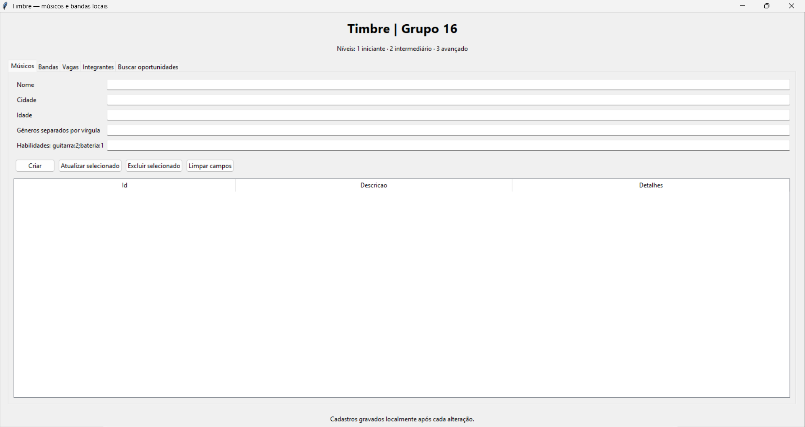

### Anexo 2 — Tela 1: Cadastro Bem-Sucedido na Aba "Músicos"
Demonstra o cadastro concluído com sucesso (`fernanda bettanin`, `canoas rs`, `21` anos, gêneros `rock, pop, funk`, habilidade `guitarra: 2`), exibindo o ID `1`, o resumo polimórfico na tabela e a confirmação de salvamento no rodapé.

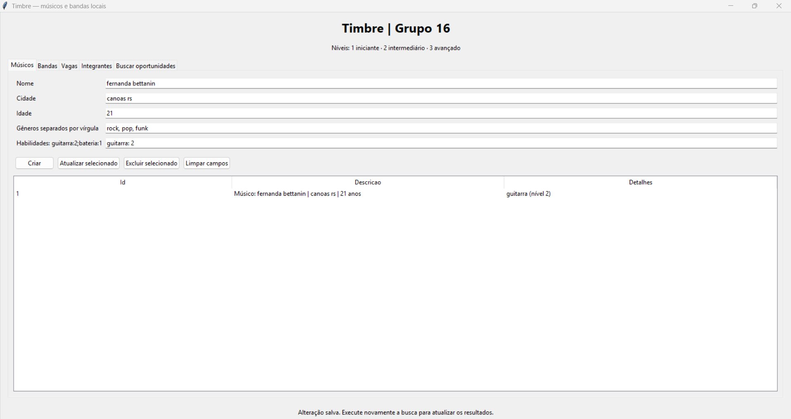

### Anexo 3 — Tela 1: Validação de Erro ao Omitir Separador `:` na Habilidade
Demonstra a mensagem de erro (`messagebox`) quando o usuário tenta informar a habilidade sem os dois-pontos (`guitarra 2`), orientando o formato correto `guitarra:2;bateria:1`.

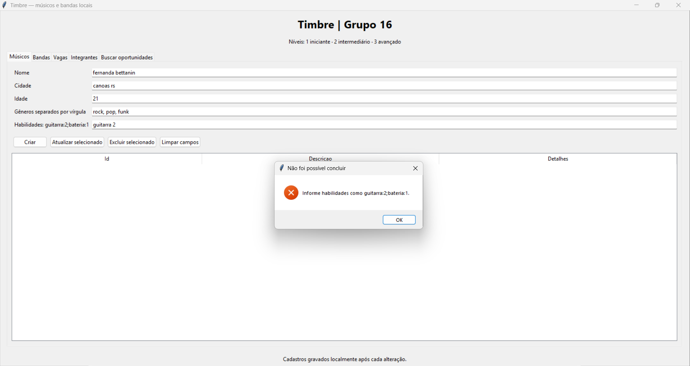

### Anexo 4 — Tela 1: Validação de Erro em Múltiplas Habilidades Fora do Padrão
Demonstra o bloqueio de cadastro quando o usuário insere múltiplas habilidades separadas por `;` (`guitarra 2; bateria 2`), mas sem o separador `:` do nível de habilidade.

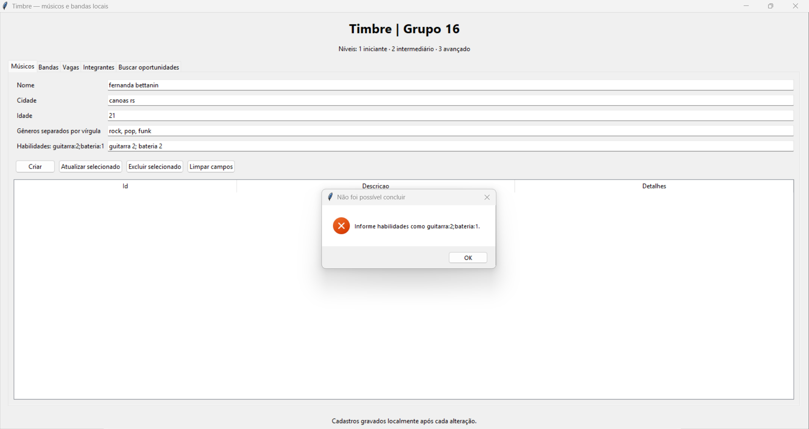

### Anexo 5 — Tela 2: Aba "Bandas"
Apresenta o formulário para cadastro, atualização e exclusão de bandas (Nome, Cidade e Estilo musical) e a tabela com ID, resumo polimórfico da banda e contagem de integrantes.

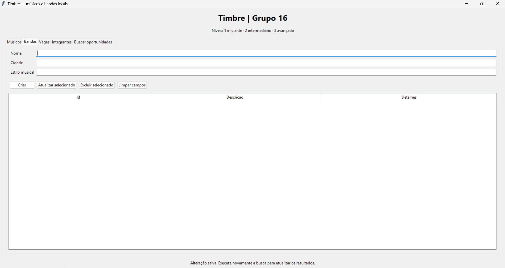

### Anexo 6 — Tela 3: Aba "Vagas"
Apresenta o formulário para publicação e manutenção de vagas abertas por uma banda (ID da banda, Instrumento, Nível mínimo de 1 a 3 e Requisitos opcionais), incluindo o botão **Encerrar / Reabrir**.

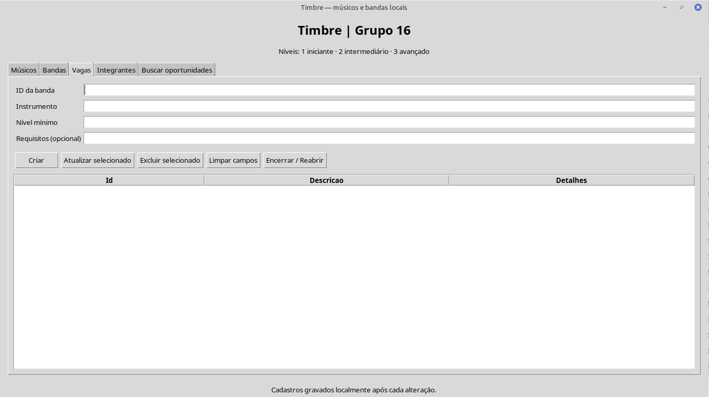

### Anexo 7 — Tela 4: Aba "Integrantes"
Apresenta os campos de ID da banda e ID do músico com os botões **Adicionar integrante** e **Remover integrante**, listando na tabela inferior as bandas e seus integrantes vinculados.

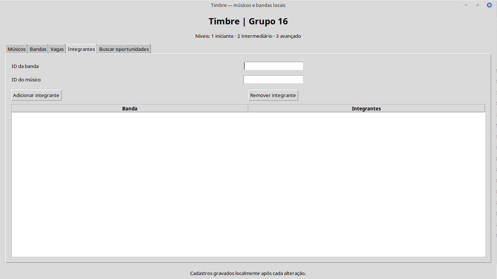

### Anexo 8 — Tela 5: Aba "Buscar oportunidades"
Apresenta o formulário de busca com ID do músico e filtros opcionais de Cidade, Instrumento e Gênero, botão **Buscar vagas compatíveis** e tabela de resultados (Banda, Cidade, Estilo, Instrumento, Nível e Requisitos).

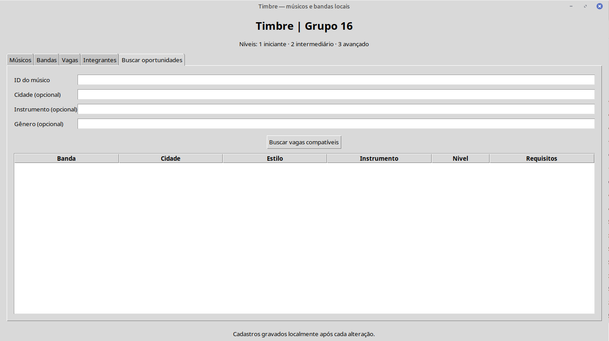

---

## 7. Exemplos de Testes

Foram implementados e executados **19 testes unitários automatizados** em `test_timbre.py` (todos aprovados: `Ran 19 tests in 0.009s — OK`), além do script `demo.py` e dos testes de validação na interface (Anexos 2, 3 e 4):

| Cenário Testado (`test_timbre.py`) | Resultado Observado |
|---|---|
| Vaga aberta, instrumento igual e nível do músico igual ao mínimo (`test_vaga_compativel_e_nivel_igual_ao_minimo`) | Retornada na busca (`OK`). |
| Nível insuficiente (`test_nivel_insuficiente`) ou instrumento diferente (`test_instrumento_diferente`) | Vaga descartada (`OK`). |
| Encerrar e reabrir vaga (`test_encerrar_e_reabrir`) | Deixa de ser compatível ao encerrar e volta a ser compatível ao reabrir (`OK`). |
| Filtros independentes de cidade, instrumento e gênero (`test_filtros_independentes`) | Vaga descartada quando qualquer filtro preenchido não coincide (`OK`). |
| Acentos, espaços extras e maiúsculas nos filtros (`test_acentos_espacos_e_maiusculas`) | Reconhece `"  SAO PAULO  "` como equivalente a `"São Paulo"` (`OK`). |
| Níveis inválidos (`0`, `4`, `True`, `"2"`) e idade negativa (`test_validacao_de_niveis_e_idade`) | Entradas recusadas com `ValueError` (`OK`). |
| Atualização inválida (`test_atualizacao_invalida_preserva_cadastro`) e criação inválida (`test_criacao_invalida_nao_cadastra`) | Estado anterior do cadastro preservado sem corrupção (`OK`). |
| Múltiplas habilidades e instrumento duplicado (`test_multiplas_habilidades_e_duplicidade`) | Aceita múltiplos instrumentos e bloqueia duplicidade (`OK`). |
| Atualizar ou excluir músico integrante de banda (`test_atualizar_musico_preserva_associacao`, `test_excluir_musico_remove_vinculos`) | Vínculos atualizados ou removidos automaticamente (`OK`). |
| Excluir banda ou vaga (`test_excluir_banda_remove_vagas_sem_afetar_outras`, `test_excluir_vaga_atualiza_banda`) | Exclusão em cascata das vagas da banda sem afetar outras bandas (`OK`). |
| Abstração e polimorfismo (`test_abstracao_e_polimorfismo`) | `Perfil` não pode ser instanciado (`TypeError`); `Musico` e `Banda` geram resumos distintos (`OK`). |
| Salvar/carregar JSON e proteção contra JSON corrompido (`test_json_preserva_dados_estados_e_associacoes`, `test_arquivo_ausente_inicia_vazio_e_corrompido_e_preservado`) | Restaura objetos, vínculos, estado da vaga e `proximo_id`; preserva arquivo corrompido (`OK`). |
| Não reutilização de IDs excluídos (`test_nao_reutiliza_id_apos_exclusao`) | Novo registro recebe ID estritamente superior ao excluído (`OK`). |

---

## 8. Limitações e Bugs Conhecidos

- **Persistência local monousuário (JSON):** os dados são gravados localmente em `data/timbre.json`, sem sincronização em rede ou banco de dados concorrente.
- **Relacionamento por IDs digitados:** para criar vagas, vincular integrantes ou buscar oportunidades, o usuário digita o ID numérico consultado nas abas correspondentes.
- **Sintaxe textual para habilidades:** o campo de habilidades exige o padrão `instrumento:nível` separado por `;` (ex.: `guitarra:2;bateria:1`).
- **Comparação textual sem sinônimos ou distância geográfica:** a normalização ignora acentos, espaços nas pontas e maiúsculas/minúsculas, mas textos estruturalmente diferentes (como `"Canoas"` vs `"Canoas RS"`) são tratados como cidades distintas.
- **Estilo único por banda e filtro explícito de gênero:** cada banda cadastra um estilo principal; na busca, a restrição por gênero é aplicada quando o campo opcional `Gênero` é preenchido.
- **Inalterabilidade da banda de uma vaga já criada:** para transferir uma vaga para outra banda pela interface, é necessário excluir a vaga e criar uma nova.

---

## 9. O que Falta Fazer (Evoluções Futuras)

1. Substituir os campos de digitação manual de IDs por caixas de seleção (`ttk.Combobox`) exibindo `ID — Nome`.
2. Substituir a entrada textual `guitarra:2;bateria:1` por controles dedicados de adição de instrumento e seletor de nível (`1`, `2` ou `3`).
3. Permitir que a busca utilize opcionalmente a lista de gêneros cadastrada no perfil do músico como filtro automático e suporte múltiplos estilos por banda.
4. Adicionar barras de rolagem (`ttk.Scrollbar`) nas tabelas `Treeview` e janela de detalhes ao selecionar uma oportunidade na busca.
5. Empacotar o aplicativo em executável standalone (ex.: `PyInstaller`) e/ou migrar a persistência para `sqlite3`.

---

## 10. Roteiro para Demonstração na Aula de 05/11

1. **Conceitos de POO no código (`modelo.py`):** mostrar a classe abstrata `Perfil` (`ABC` e `@abstractmethod resumirPerfil`), a herança em `Musico` e `Banda`, os atributos protegidos (`_`) e privados (`__`), o método protegido `_validarDados()` e o método privado `Vaga.__validarNivel()`.
2. **Testes e demonstração no terminal:** executar `python3 -m unittest -v` (19 testes aprovados) e `python3 demo.py`.
3. **Demonstração ao vivo na interface (`python3 app.py`):**
   - Cadastrar um músico na aba **Músicos** (e demonstrar a validação de erro caso falte `:`);
   - Cadastrar uma banda na aba **Bandas** e vinculá-los na aba **Integrantes**;
   - Publicar uma vaga compatível na aba **Vagas**;
   - Executar a busca na aba **Buscar oportunidades** e mostrar a vaga encontrada;
   - Alternar o estado da vaga em **Encerrar / Reabrir** e repetir a busca;
   - Fechar e reabrir o programa para demonstrar a persistência em `data/timbre.json`.
